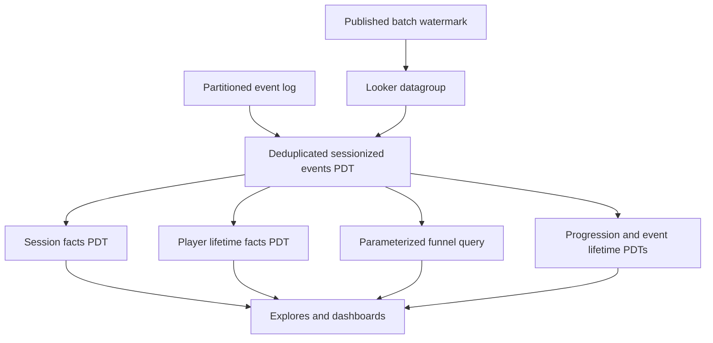
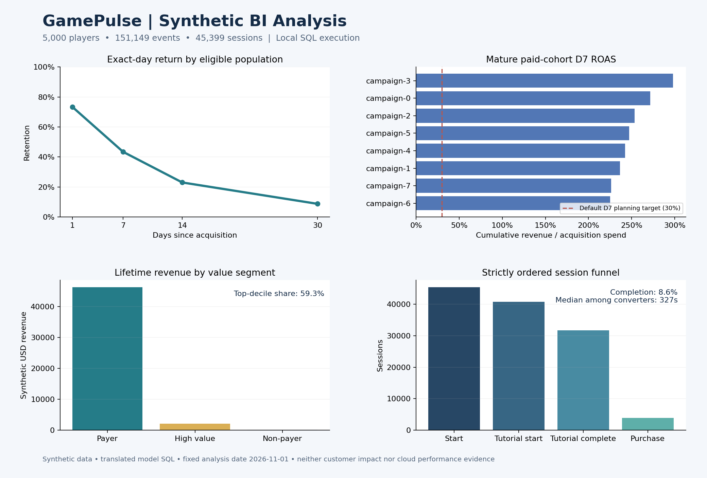

# GamePulse — Gaming Analytics & BI Platform

A Looker semantic layer for understanding how players engage, return, progress, and monetize across a game portfolio. Business teams can explore event details, session summaries, player lifetime value, acquisition ROI, and ordered conversion funnels using shared metric definitions.

## Features

- Daily engagement dashboard: active players, revenue, sessions, and date trends.
- Monetization dashboard: lifetime revenue, acquisition spend, ROAS, and mature-cohort D7 retention.
- Four-step parameterized funnel with strict event ordering and session conversion rates.
- D1, D7, D14, and D30 retention with fully observed UTC-day denominators.
- In-app and advertising revenue, ARPU, ARPPU, payer conversion, churn, and value segments.
- Player progression and first/latest timestamps for twelve gameplay event types.
- Thirty-minute inactivity sessionization, deterministic event ordering, latest-ingestion deduplication, and multi-game player isolation.
- Partitioned, clustered persistent derived tables and publication-driven cache invalidation.
- Deterministic SQL workload configurable from 1 to 50 million events and executable warehouse assertions.

## Technology

LookML, Looker dashboards, Google BigQuery Standard SQL, Liquid parameters, and YAML dashboard definitions. No application server, REST API, frontend framework, or external runtime package is required. Looker is a licensed deployment prerequisite; this is not a Looker Studio report.

## Quick start

1. Create a GitHub repository and upload the contents of this folder, including hidden `.github` files.
2. Follow [deployment instructions](docs/DEPLOYMENT.md) to provision BigQuery and connect Looker.
3. Run the schema, seed, and assertion scripts in `sql/` in order. The default seed creates 100,000 synthetic events.
4. Configure a Looker BigQuery connection named `gamepulse_bigquery` with a writable PDT scratch dataset.
5. Connect this repository to a Looker project, select `gamepulse`, run LookML validation, build PDTs, and validate dashboard content before deploying.

## Architecture

Core folders retain the event view, derived tables, model, and LookML dashboard architecture. State lives in BigQuery tables, Looker PDTs, and the datagroup cache. [Architecture and metric definitions](docs/ARCHITECTURE.md) describe grains, joins, refresh behavior, and limitations.

## Repository guide

| Path | Purpose |
|---|---|
| `gamepulse.model.lkml` | Connection, includes, datagroup, explores, join contracts |
| `views/events.view.lkml` | Deduplication, sessions, event dimensions and measures |
| `derived_tables/` | Session, player, event-history, funnel, progression, country models |
| `lookml_dashboards/` | Three dashboard definitions |
| `sql/` | Schema, synthetic workload, assertions, benchmark queries, regression fixture, regression fixture |
| `docs/` | Deployment, data contract, architecture, performance, operations, changes |

## Validation and scale

The 50M-event setting is a reproducible workload configuration, not a claim of an executed benchmark. No BigQuery or Looker credentials are included. Local dashboard syntax and dependency checks do not replace Looker's validator or BigQuery execution. See [performance methodology](docs/PERFORMANCE.md) for capturing actual job evidence.

## Documentation

- [Database contract and querying](docs/DATA_CONTRACT.md)
- [Deployment and GitHub upload](docs/DEPLOYMENT.md)
- [Operations and release checks](docs/OPERATIONS.md)
- [Implementation changes and remaining improvements](docs/CHANGES.md)

## License

MIT. Copyright notices are retained in [LICENSE](LICENSE).

## Extended BI analysis

Four additional dashboards complement the original three: cohort retention, campaign ROI, monetization segments, and funnel diagnostics. They integrate through the existing LookML model and preserve previous fields and dashboard definitions.

- [BI module guide and metric semantics](docs/BI_MODULES.md)
- [Worked business analysis with executed synthetic results](docs/DEMO_ANALYSIS.md)
- [Validation evidence and release limits](docs/VALIDATION.md)

The chart summarizes reproducible local synthetic results, not a screenshot of a deployed Looker dashboard. Run `python -m unittest discover -s tests -v` after installing `requirements-dev.txt` for regression and compatibility checks. Python packages are development dependencies only.
