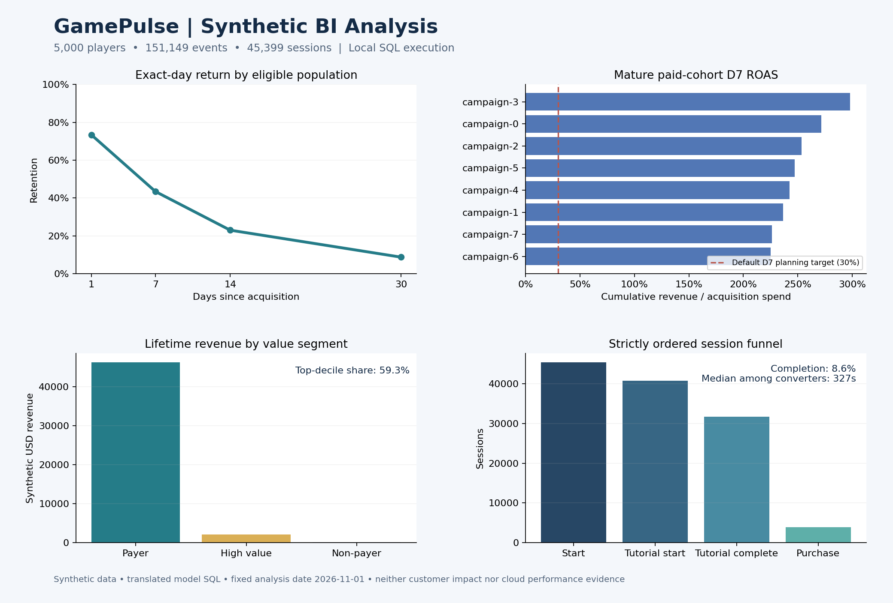

# Worked BI analysis: retention, monetization, and purchase conversion

## Business question

Which part of the player lifecycle deserves investigation before increasing paid acquisition spend?

## Dataset and execution

This is a synthetic analytical exercise, not a customer engagement or claimed business outcome. The executed local workload contains **5,000 players**, **151,149 events**, and **45,399 sessions**. Analysis is fixed as of 2026-11-01 with activity anchored to 2026-10-31. The checked-in [raw results](evidence/local_demo_results.json) are computed from the current model SQL, translated for local execution. The local SHA256 bucket generator and BigQuery FARM_FINGERPRINT demo use the same distribution rules but produce different individual records.



## Findings

| Question | Executed synthetic result | Interpretation |
|---|---|---|
| Are players returning? | D1 73.4%; D7 43.4%; D30 8.8% | Age-specific eligible populations differ; compare fully mature cohorts before attributing changes to product experience |
| Which funnel step loses the most sessions? | Tutorial complete → purchase: 31,752 → 3,896, or 87.7% abandonment | Largest observed conversion loss in this generated journey |
| How concentrated is revenue? | Top lifetime decile accounts for 59.3% of revenue | Segment-level sensitivity analysis is useful before changing offers |
| Do paid campaigns miss the default D7 target? | D7 ROAS ranges from 225.0% to 298.0%; every paid campaign exceeds the 30% planning target | This dataset does not justify a below-target spending cut |
| How long do successful purchases take? | Median 327 seconds from session start | Converter-only timing; excludes censored/abandoned sessions |

## Recommendation

Investigate the transition from tutorial completion to purchase first: inspect purchase-start/error instrumentation, offer eligibility, and platform differences. A purchase is optional behavior, so a large dropoff alone does not establish a defect. If event coverage is sound, define an experiment on offer presentation and monitor purchase conversion together with D7 retention and ad revenue per player as guardrails.

Do not cut a campaign solely because it ranks last. The lowest synthetic campaign still exceeds the configured D7 target and has 427 paid mature players. Check incrementality, uncertainty, acquisition quality, and longer-term contribution before changing allocation. The software's below-target and insufficient-sample branches are exercised separately by regression fixtures.

## Limitations

Return probabilities, offer eligibility, and payer behavior are generated assumptions. Findings describe the generated workload only. No causal effect, statistically significant uplift, actual budget savings, or production scale is established. Lifetime value segments can change as players accumulate revenue; revenue ranks are fixed within each game's lifetime population rather than recomputed after dashboard filters. Date filtering in the new dashboards selects acquisition cohorts; select the complete fixture cohort range to compare against this report.

## Reproduce

From the repository root:

```bash
python -m pip install -r requirements-dev.txt
python scripts/demo_analysis.py --players 5000 --output /tmp/gamepulse-demo-results.json
python scripts/render_demo.py /tmp/gamepulse-demo-results.json /tmp/gamepulse-demo-analysis.png
```

For target-environment analysis, load the optional varied demo in a dedicated BigQuery project, run native validation, build the PDTs, and render the new Looker dashboards. Recompute findings there; the local chart is not a Looker screenshot.
